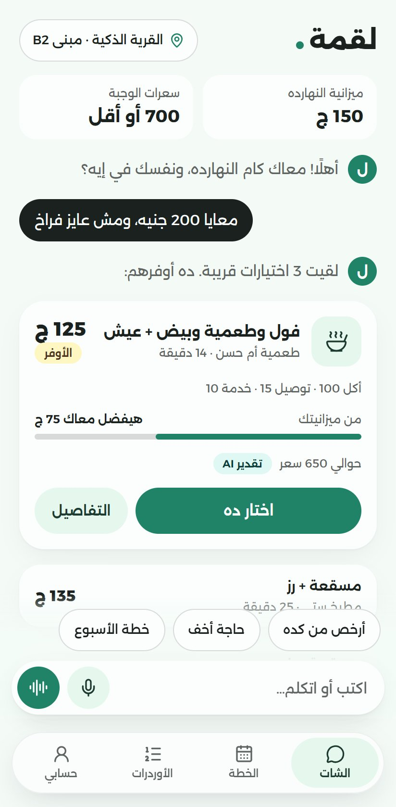
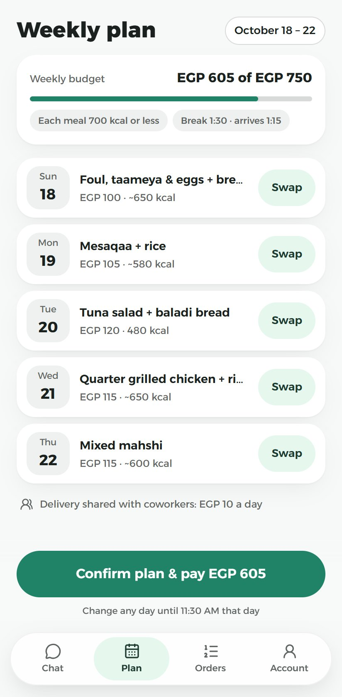
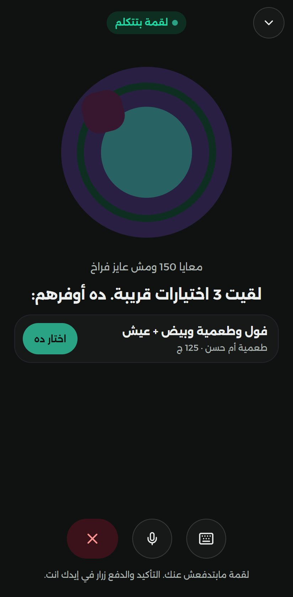
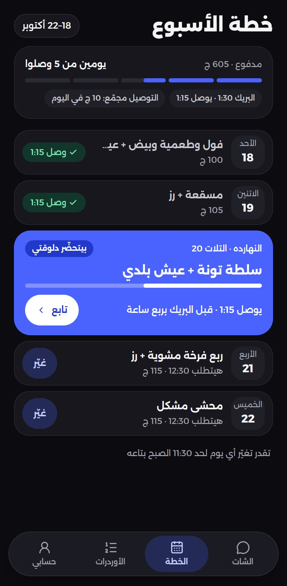
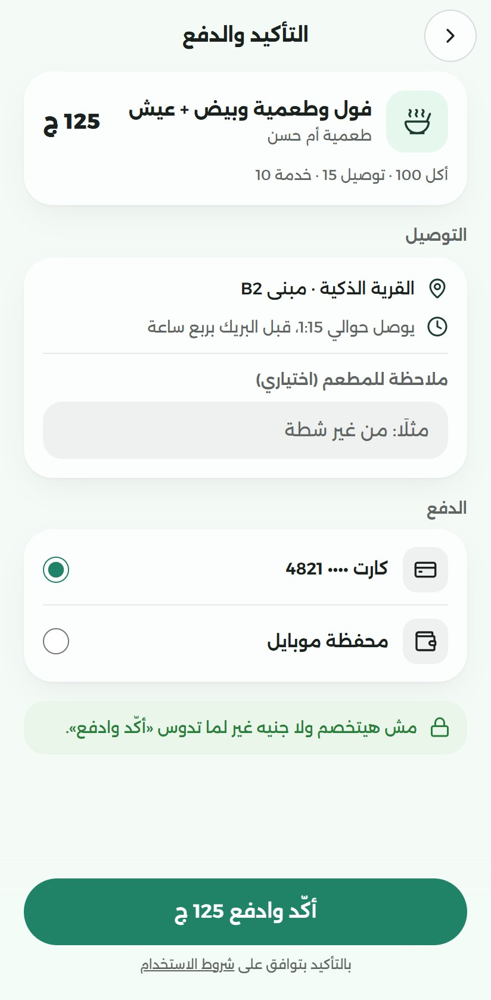
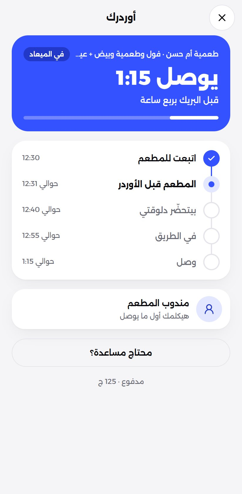
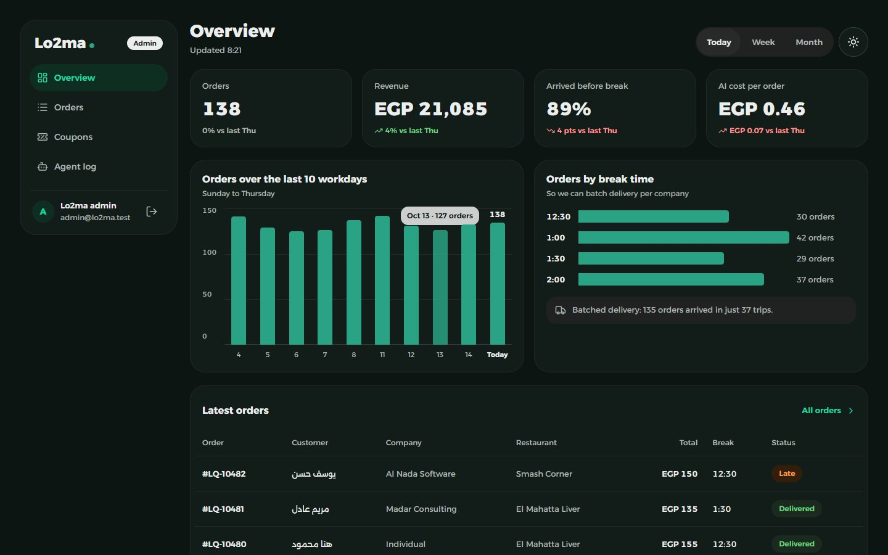
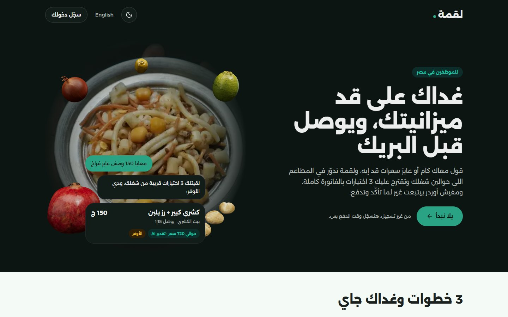
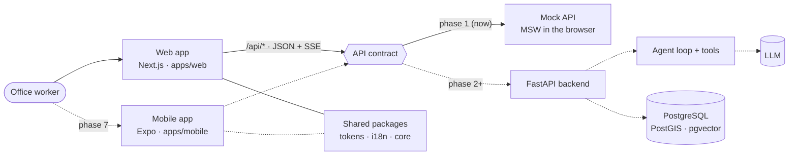

# Lo2ma · لقمة

**An AI lunch agent for office workers in Egypt.** Tell it your budget or a calorie target, in Egyptian Arabic or
in English, and it suggests three meals near your office with the full bill. It can also plan the week's lunches
so each one arrives before your break. Nothing is ordered until you confirm and pay yourself.

> **Status:** the web frontend is complete. It runs on a mock API (MSW) that is also the contract the backend has
> to match. The FastAPI backend, the real agent and the mobile app are next (see the [roadmap](#roadmap)).

<table>
  <tr>
    <td align="center"><br /><sub>Chat · Arabic</sub></td>
    <td align="center"><br /><sub>Weekly plan · English</sub></td>
    <td align="center"><br /><sub>Voice call · dark</sub></td>
    <td align="center"><br /><sub>The week, day by day</sub></td>
  </tr>
  <tr>
    <td align="center"><br /><sub>Checkout</sub></td>
    <td align="center"><br /><sub>Tracking</sub></td>
    <td colspan="2" align="center"><br /><sub>Admin dashboard</sub></td>
  </tr>
</table>

<p align="center"></p>

## Contents

- [What it does](#what-it-does)
- [Safety by design](#safety-by-design)
- [How it works](#how-it-works)
- [Tech stack](#tech-stack)
- [Engineering practices](#engineering-practices)
- [Getting started](#getting-started)
- [Trying the demo](#trying-the-demo)
- [Roadmap](#roadmap)
- [More documentation](#more-documentation)
- [License](#license)

## What it does

- **Chat in Egyptian Arabic or English.** "I have 200, no chicken" becomes three meal suggestions near the office.
  Each one shows the whole bill (food, delivery and service), how much of the budget is left, the delivery time,
  and a calorie estimate that always says where the number comes from.
- **A weekly lunch plan.** Five workdays (Sunday to Thursday), each with a meal timed to arrive before the break.
  Any day can be swapped until its cut-off. The week is confirmed and paid once, then followed day by day.
- **Voice.** Dictation writes what you said into the message box so you can fix it before sending. A call mode
  lets you talk to Lo2ma with live captions, and you pick the meal with a button.
- **Checkout and tracking.** Guests can browse and chat freely. Paying asks for a one-time code by phone or email.
  After paying, the order moves along its timeline.
- **An admin dashboard** with its own sign-in (password plus authenticator code): the day's numbers, orders with
  filters and export, coupons, and a log of every step the agent took in each conversation.
- **Arabic first.** Arabic (right to left) is the default and English is one click away, both in light and dark.
  Money reads «150 ج» in Arabic and «EGP 150» in English.

## Safety by design

An agent that spends money has to be boringly predictable about it.

- **The model can't confirm or pay.** It never gets a tool for either. Payment is a button the user presses,
  and that button calls the backend directly.
- **Voice can only talk.** Dictated words wait in the box for the user to send, and a call shows the meal with a
  button. Neither can order anything.
- **Every number has a source.** Calorie figures are labelled («AI estimate»), and every suggestion shows its bill
  before the user commits.
- **Minimum order rules live in one place:** 100 EGP of food before fees, as a single constant shared by every
  screen, the mock API and later the backend.

## How it works



- **One contract.** Every request goes through one `api()` helper that validates the response with a zod schema
  from `packages/core`. Today the requests are answered by MSW handlers, and those handlers (pinned by tests) are
  the contract FastAPI will implement. Switching to the real backend is one environment variable.
- **Streaming replies.** The chat reply arrives as server-sent events: words first, then the suggestion cards.
- **Money in piasters** from end to end, formatted only at the edge.

### Repository layout

```text
apps/
  web/              Next.js app: the customer app, the landing page and the admin dashboard
  mobile/           Expo app (planned, phase 7)
backend/            FastAPI service (planned, phase 2)
packages/
  tokens/           design tokens: colors, radii, spacing, type, shadows, layout → Tailwind CSS
  i18n/             every user-facing string, in Arabic and English (ICU messages)
  core/             zod schemas, formatters, money, calorie and time math, business rules
docs/screenshots/   the images in this README (regenerated by a script)
```

The three packages are plain TypeScript with no browser or Node globals, so the web app, the tests and later the
mobile app all share them.

## Tech stack

| Layer                | Choice                                                                |
| -------------------- | --------------------------------------------------------------------- |
| Framework            | Next.js 16 (App Router, Turbopack), React 19 with the React Compiler  |
| Language             | TypeScript 6, strict, no `any`                                        |
| Styling              | Tailwind CSS 4 on our own design tokens, a small Radix-based UI kit   |
| Text and languages   | next-intl with ICU messages, Arabic (RTL) and English (LTR)           |
| Data                 | TanStack Query for server data, Zustand for the chat conversation     |
| Forms and validation | react-hook-form + zod 4                                               |
| Mock API             | MSW 3, also the API contract                                          |
| 3D                   | React Three Fiber + drei + three.js, loaded only where it is used     |
| Tests                | Vitest + Testing Library, Playwright + axe, Lighthouse                |
| Planned backend      | FastAPI, Pydantic, SQLAlchemy 2, PostgreSQL with PostGIS and pgvector |
| Planned mobile       | Expo, Expo Router, NativeWind, sharing the same packages              |

Every dependency is pinned to an exact version.

## Engineering practices

- **One source of truth.** Colors, spacing and type come only from `packages/tokens`; every string comes from
  `packages/i18n`; every rule and formula comes from `packages/core`. ESLint fails the build on a raw color, a
  string in JSX, or a physical direction class.
- **Right to left done properly.** Only logical CSS (`ms-`, `pe-`, `text-start`), `lang` and `dir` set once on
  `<html>`, directional icons that flip, and mixed-direction text isolated in `<bdi>`.
- **Accessible.** Semantic HTML, labels on every control, 44 px touch targets, 4.5:1 contrast checked by tests in
  both themes, and reduced motion respected (the 3D falls back to a still picture).
- **Fast where it matters.** Server Components by default, client code only on interactive leaves, messages kept
  on the server, and three.js loaded lazily only on capable devices.
- **Found by search engines and AI assistants.** Canonical and hreflang links, link previews in both languages,
  JSON-LD structured data, a sitemap, a robots.txt that welcomes AI crawlers, and an `llms.txt`, all generated
  from the same messages as the pages.
- **Tested.** About 700 unit tests across the packages and the app, the mock API contract pinned by its own
  tests, and Playwright journeys that run in Arabic and English, light and dark (100 runs), with an axe
  accessibility scan on every screen.

Lighthouse on the production build, as a phone: accessibility is 100 on every audited page, and the landing page
scores 93 to 94 for performance. The app screens carry the in-browser mock API until the backend replaces it.

## Getting started

You need Node.js 22 or newer and npm.

```bash
npm install
npm run dev          # http://localhost:3000 opens the Arabic app at /ar
```

| Command                             | What it does                                              |
| ----------------------------------- | --------------------------------------------------------- |
| `npm run dev`                       | the web app in development                                |
| `npm run build`                     | a production build of the web app                         |
| `npm run check`                     | typecheck, lint, every unit test and the format check     |
| `npm run e2e -w @lo2ma/web`         | Playwright journeys on the production build (build first) |
| `npm run lighthouse -w @lo2ma/web`  | Lighthouse as a phone on the production build             |
| `npm run screenshots -w @lo2ma/web` | retakes the images in this README                         |
| `npm run images -w @lo2ma/web`      | redraws the link preview cards and the app icons          |
| `npm run build -w @lo2ma/tokens`    | regenerates the CSS from the design tokens                |

The end-to-end tests and the screenshot script use the Chrome that is already installed, so nothing is downloaded.

## Trying the demo

Everything runs in the browser on mock data, so any account works:

- **Customer sign-in:** an Egyptian mobile number (such as `010 1234 5678`) or any email, then any 6-digit code.
  `000000` shows the wrong-code state.
- **Admin sign-in** at `/admin`: any `@lo2ma.test` email with a password of 8 or more characters, then any
  6-digit code except `000000`.
- An order moves one step along its timeline every 8 seconds.
- The 30 restaurants are fictional. The demo keeps its data in the browser's local storage, so clearing the
  site's data starts over.

## Roadmap

| Phase | Scope                                                                                    | Status  |
| ----- | ---------------------------------------------------------------------------------------- | ------- |
| 0     | Product plan and design system, every screen designed in Arabic and English              | Done    |
| 1     | The web frontend on a mock API, admin dashboard, voice and 3D included                   | Done    |
| 2     | FastAPI, PostgreSQL with PostGIS and pgvector, seed data, search, a generated API client | Next    |
| 3     | The agent loop and its tools, evaluation sets, speech-to-text for Egyptian Arabic        | Planned |
| 3.5   | Real voice calls: speech-to-text, the same agent, Egyptian text-to-speech                | Planned |
| 4     | Order drafts and confirmation, sandbox payments, webhooks, idempotency, coupons          | Planned |
| 5     | The weekly plan for real: scheduled sending, refusals and delays                         | Planned |
| 6     | Deployment, model comparison by evaluations                                              | Planned |
| 7     | The mobile app with Expo, on the same shared packages                                    | Planned |

## More documentation

- [apps/web](apps/web/README.md): the web app in depth, its conventions, and deploying it to Vercel
- [backend](backend/README.md): the planned FastAPI service and the API it has to implement
- [apps/mobile](apps/mobile/README.md): the planned Expo app

## License

Copyright © 2026 MoSalah07. All rights reserved.

This repository is public so the work can be read and reviewed. No license is granted to copy, modify or
distribute the code.
